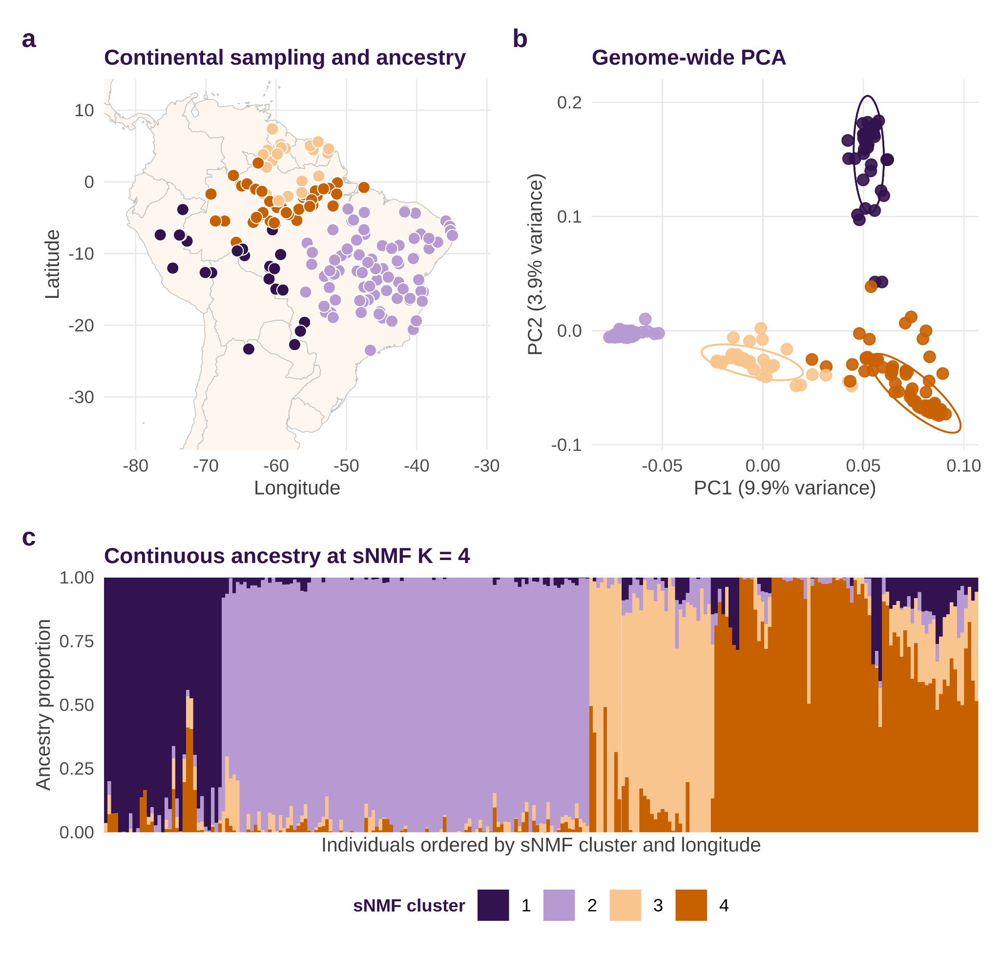
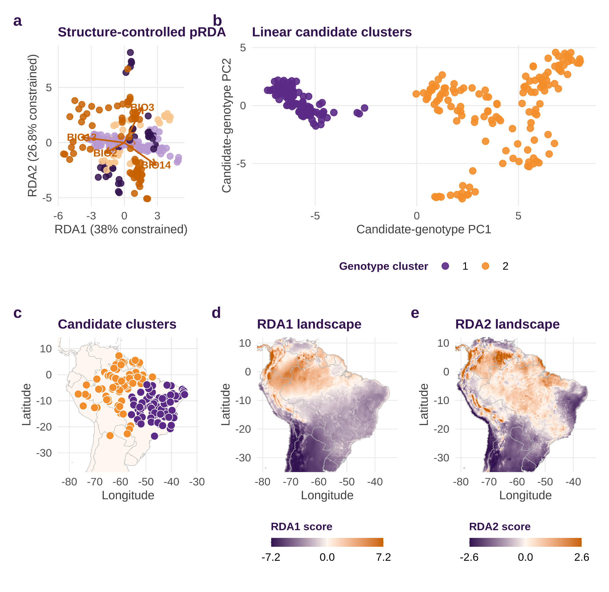
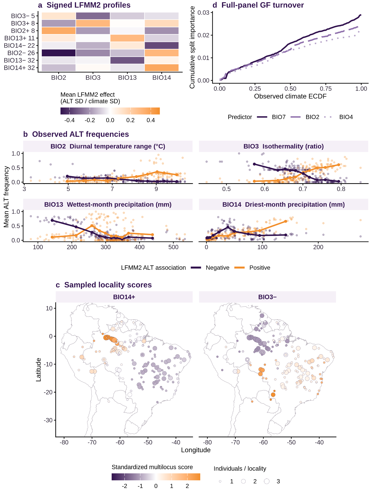
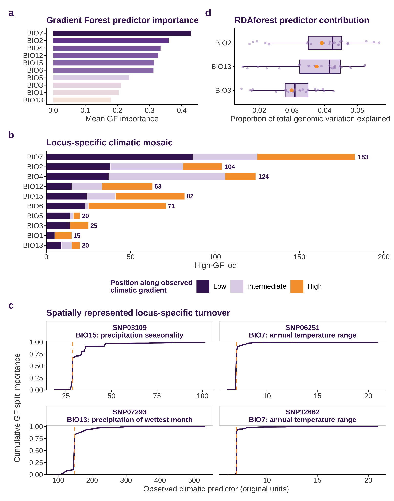
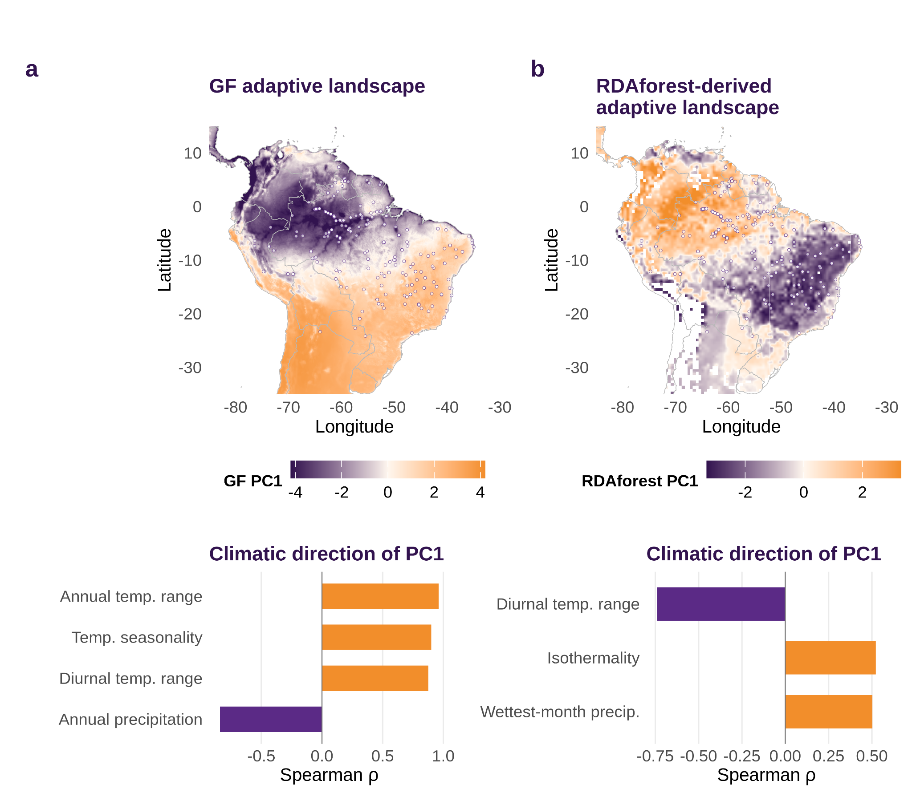
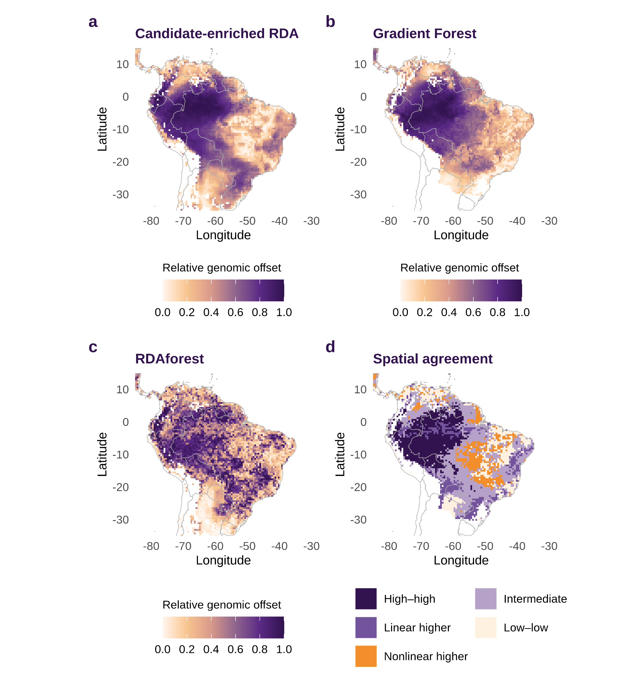

# Beyond generalism

### Following genomic variation across the ecological range of *Ameiva ameiva*

*Ameiva ameiva* occurs across very different South American environments, from humid forests to seasonal savannas and dry open habitats. I wanted to know whether a lizard with such a broad distribution carries a relatively uniform genomic response to climate, or whether different parts of its range contain different combinations of climate-associated variants.

I started with RADseq genotypes and worked through population structure, linear genotype–environment associations, nonlinear models and spatial projections. The sequence below follows the actual analyses. I include pieces of my R scripts because the choices behind a model often become clearer when you can see how I implemented them.

The six figures follow the order of Chapter 1 in the R7 thesis. This repository may be updated as the associated publications progress. The [figure notes](docs/figures.md) connect the plates to the scripts and saved inputs; the [methods notes](docs/methods.md) distinguish panels and controls. I also explain [what still needs checking](docs/known_limitations.md) before another study reuses these projections.

**Jump to:** [genotypes](#1-from-a-stacks-vcf-to-the-genomic-matrix) · [structure](#2-population-structure-comes-first) · [climate](#4-which-climatic-variables-should-enter-the-model) · [pRDA](#5-partial-rda-separating-climate-from-structure) · [LFMM2](#6-lfmm2-and-a-shared-candidate-set) · [candidate geography](#7-where-the-candidate-alleles-actually-occur) · [GF](#8-gradient-forest-when-a-straight-line-is-not-enough) · [RDAforest](#9-rdaforest-another-view-of-nonlinear-genomic-variation) · [present landscapes](#10-present-day-genomic-landscape-maps) · [genomic offset](#11-genomic-offset-under-future-climate) · [annotation](#12-looking-at-genes-without-letting-annotation-drive-the-story)

## 1. From a Stacks VCF to the genomic matrix

I begin with the Stacks VCF, individual metadata and an environmental table. Before any association test, I need to know which individuals survive both the genetic filtering and the environmental-data match.

In the [core analysis](https://github.com/Nadaline/Beyond_generalism_a_climate_genomic_mosaic_on_neotropics/blob/main/analysis/01_core/RDA-2027-bonferroni.R), I first apply a 70% call-rate threshold by locus and by individual and remove monomorphic or entirely missing loci:

```r
ref_dart <- gl.filter.callrate(
  ref_dart, method = "loc", threshold = .70, verbose = 0
)
ref_dart <- gl.filter.callrate(
  ref_dart, method = "ind", threshold = .70, verbose = 0
)
ref_dart <- gl.filter.monomorphs(ref_dart, verbose = 0)
ref_dart <- gl.filter.allna(ref_dart, verbose = 0)
```

The genetically filtered panel had **250 individuals**. Five lacked the corresponding environmental information, leaving **245** for the landscape analyses. I use the shared `InternalID` rather than relying on the original row order.

I then return to the VCF and apply the final variant filter **after** choosing those 245 individuals: no more than 30% missing genotypes and a minimum of three copies of each allele. This leaves **14,134 SNPs**.

```r
# This is the inclusion condition used in the bcftools filtering step:
F_MISSING <= 0.30
AC >= 3
(AN - AC) >= 3
```

The three lines above describe VCF inclusion conditions, not standalone R commands. When I build the genotype matrix, I explicitly translate diploid VCF calls into alternative-allele dosages: 0/0 → 0, 0/1 → 1, and 1/1 → 2. This matters later when I interpret the direction of allele-frequency associations. I also keep the original SNP identifiers so that the genomic matrix, association tables and gene annotations can be joined without guesswork.

**Next:** before asking which variants relate to climate, I examine how the whole genome is structured.

## 2. Population structure comes first

The species spans regions that differ in geography and population history, not just temperature and rainfall. I use PCA to summarize continuous genomic differences and sNMF to describe ancestry components. These are complementary summaries; neither one defines a set of biologically isolated populations by itself.

For the main structure analysis, I retained **K = 4** ancestry components. The numerical mean cross-entropy minimum continued toward the maximum K tested, so I did not choose four by claiming it was the absolute minimum. I considered the inflection in the curve, biological interpretation and agreement with the earlier analysis. The choice is recorded in the core script.

```r
bestK <- SNMF_SELECTED_K
best_run <- which.min(cross.entropy(snmf_project, K = bestK))
Q <- LEA::Q(snmf_project, K = bestK, run = best_run)
Q <- sweep(Q, 1, rowSums(Q), "/")
```

The broad components distinguish regional ancestry across northern Amazonia and the Guianas, southern Amazonia, the Cerrado–Caatinga–Atlantic Forest region, and the Chaco–Andes–western Amazonian region. I also compare a genome-wide PCA with a one-SNP-per-RAD-locus version, because linked SNPs can influence the geometry of an ordination.



*Figure 1.* Localities coloured by predominant ancestry, scaled PCA and individual sNMF proportions at K = 4. [PDF](results/figures/Figure_1_continental_structure.pdf) · [Renderer](scripts/render_ameiva_publication_figures.R) · [Structure code](https://github.com/Nadaline/Beyond_generalism_a_climate_genomic_mosaic_on_neotropics/blob/main/analysis/01_core/RDA-2027-bonferroni.R).

## 3. Putting geography and demographic history in context

I also prepared TreeMix and Stairway Plot 2 analyses to examine population relationships and demographic histories. I keep them separate from the genotype–environment tests: a historical change in effective population size or an inferred migration edge is not itself evidence that climate selected a particular SNP.

For Stairway Plot 2 I used broad sNMF groupings. TreeMix and the geographic diversity summaries instead used ten geographic groups; these are not subdivisions implied by the four sNMF bars. The group definition changes the biological question, particularly when admixed individuals are assigned to discrete groups.

The inputs and commands are described in the [core script](https://github.com/Nadaline/Beyond_generalism_a_climate_genomic_mosaic_on_neotropics/blob/main/analysis/01_core/RDA-2027-bonferroni.R). This historical context helps me ask whether a geographic genetic pattern could have arisen without a direct climatic explanation.

## 4. Which climatic variables should enter the model?

Many bioclimatic variables describe overlapping aspects of temperature and precipitation. Including everything would make interpretation difficult and can create redundancy. I examined environmental redundancy with Boruta/VIF screening and used forward selection on the unconditioned RDA, before fitting the conditioned candidate-detection models.

```r
RDA0 <- rda(geno_complete ~ 1, data = Environment_selection)
RDAfull <- rda(geno_complete ~ ., data = Environment_selection)

RDA_forward_josue <- ordiR2step(
  RDA0,
  scope = formula(RDAfull),
  direction = "forward",
  Pin = .01,
  R2permutations = 1000,
  R2scope = TRUE,
  permutations = 999,
  trace = TRUE
)
```

The selected variables for the main linear genotype–environment analyses were **BIO2** (mean diurnal temperature range), **BIO3** (isothermality), **BIO13** (precipitation of the wettest month) and **BIO14** (precipitation of the driest month).

My nonlinear Gradient Forest analysis takes a different route: it uses ten predictors, BIO1–BIO7, BIO12, BIO13 and BIO15. The models are asking related questions, but they do not use identical environmental inputs.

## 5. Partial RDA: separating climate from structure

In redundancy analysis, my response matrix contains allele dosages; climatic variables are the predictors. A simple RDA can describe their shared variation, but I am especially interested in the component associated with climate after accounting for broad genetic structure and geography.

```r
formula_geo <- as.formula(paste(
  "geno_complete ~", paste(names(Environment), collapse = " + "),
  "+ Condition(PC1 + PC2 + PC3 + lon + lat)"
))
RDA_geo <- rda(formula_geo, data = RDA_data)
```

I compare this conditioning with an alternative that uses sNMF ancestry coefficients and geographic coordinates. To identify candidate SNPs, I scan locus loadings using a Bonferroni threshold of **0.01 / 14,134** and intersect the candidates from the two geographically conditioned models. This yields **889 consensus pRDA candidates**.

A stricter three-standard-deviation criterion gives **626 candidates**. The R7 calls the **889-SNP partial-RDA consensus** the landscape-RDA candidate panel. The documented projection command instead fits a separate climate-only RDA on the strict subset and writes both the present axes and future offset files used by the rendering code. The renderers read those files by name, which does not establish the contents of the exact files used in R7. See [the two input chains](docs/figures.md#tracing-the-rda-surfaces).

[Core pRDA and locus scan](https://github.com/Nadaline/Beyond_generalism_a_climate_genomic_mosaic_on_neotropics/blob/main/analysis/01_core/RDA-2027-bonferroni.R)

## 6. LFMM2 and a shared candidate set

I use LFMM2 as a complementary linear genotype–environment method. With **K = 4** latent factors, each selected climatic predictor is tested against the same imputed 245 × 14,134 allele matrix. I use genomic-control calibration and Benjamini–Hochberg FDR correction.

```r
fit_LFMM2 <- LEA::lfmm2(
  input = geno_complete,
  env = X_predictor,
  K = K_LFMM2
)
test_LFMM2 <- LEA::lfmm2.test(
  object = fit_LFMM2,
  input = geno_complete,
  env = X_predictor,
  full = FALSE,
  genomic.control = TRUE
)
```

The final LFMM2 set has **314 unique SNPs at q ≤ 0.05**. Its intersection with the **889 pRDA candidates** contains **164 SNPs**. I find that overlap useful for studying variants supported by both approaches, but the methods are not identical and their agreement is not an independent experiment demonstrating selection.

The original LFMM2 test results did not preserve the coefficient object. I later refitted its recorded specification to recover signed effects and checked that the original z scores and P values were numerically reproduced. This gives me interpretable directions without guessing signs from P values.



*Figure 2.* Panel a shows the conditioned ordination; b and c show the genotype PCA and geography of the **164 shared candidates**; d and e display the present-day RDA axes. These are three distinct uses of genomic data. [PDF](results/figures/Figure_2_linear_climate_associations.pdf) · [Renderer](scripts/render_ameiva_publication_figures.R) · [Saved inputs](docs/figures.md).

## 7. Where the candidate alleles actually occur

The question that pushed this part of the study forward was simple: where do different climate-associated sets of SNPs occur, and how do their frequencies change along the climate gradients?

For each of the 164 shared SNPs, I identified the strongest significant signed LFMM2 association among BIO2, BIO3, BIO13 and BIO14. This gives eight groups: a positive and a negative group for each variable. Positive and negative refer to the **VCF ALT-dosage slope**, not to good or bad alleles.

I then summarized mean ALT dosage within each group. This is one of the calculations in the [candidate-geography script](https://github.com/Nadaline/Beyond_generalism_a_climate_genomic_mosaic_on_neotropics/blob/main/analysis/10_candidate_directionality/06_candidate_directionality_all_groups_v4.R):

```r
loci <- groups$stacks_id[groups$group == g]
y <- rowMeans(geno[, loci, drop = FALSE]) / 2
```

Because the matrix is coded 0, 1 or 2, dividing by two puts the mean on an allele-frequency scale from zero to one. I summarize individuals at their sampled localities and show descriptive frequencies over ten climate-quantile intervals. Those lines are not fitted LFMM2 curves.



*Figure 3.* Signed ALT associations and RAD-locus counts (a), observed ALT frequencies (b), BIO14+ and BIO3− multilocus profiles (c), and turnover from the controlled full-panel GF (d). [PDF](results/figures/Figure_3_candidate_directionality.pdf) · [Plotting script](https://github.com/Nadaline/Beyond_generalism_a_climate_genomic_mosaic_on_neotropics/blob/main/analysis/10_candidate_directionality/07_candidate_directionality_figure_v5.R) · [Aggregate group counts](https://github.com/Nadaline/Beyond_generalism_a_climate_genomic_mosaic_on_neotropics/blob/main/results/candidate_directionality_v4/30_v4_group_counts.csv).

The thermal groups show some of the clearest opposing marginal trends. Precipitation groups are more heterogeneous: BIO13− decreases strongly along wettest-month precipitation, whereas BIO13+ and BIO14− illustrate why a geographic frequency trend need not reproduce the direction of an association conditioned on population structure.

I checked the direction of the group-level relationships with fractional-response models that included genome-wide PC1–PC3 and coordinates, examined the existing four spatial checkerboard folds, and repeated the summaries with one SNP per RAD locus. These are ways of checking the stability of the patterns, not new candidate-discovery experiments. The candidate and genome-wide PC1 scores remain strongly associated (Spearman's ρ = 0.907), which I take into account when discussing the geography. [Tables and diagnostic figures](https://github.com/Nadaline/Beyond_generalism_a_climate_genomic_mosaic_on_neotropics/blob/main/docs/figure_provenance.tsv) provide the details.

## 8. Gradient Forest: when a straight line is not enough

A linear association captures one direction across a gradient. It does not tell me whether most of the genomic change is concentrated within a narrower range of environmental values. Gradient Forest (GF) uses regression trees to describe such non-uniform associations.

I fitted the **14,134-SNP full-panel GF** both to raw dosages and to standardised residuals after removing PC1–PC3, longitude and latitude. The distinction matters: a split on temperature can otherwise recover allele-frequency differences among geographically separated ancestry groups. GF uses ten non-quarterly climatic predictors on empirical percentile scales. I kept more gradients than in the linear models because trees can use nonlinear splits and need not estimate one linear coefficient per predictor. Correlated gradients can still share importance. The **32 computational batches**, with **500 trees per SNP** and **mtry = 3**, are for fitting and saving results, not genomic blocks or independent tests.

```r
block_id <- rep(seq_len(N_BLOCKS), length.out = length(GF_names))
GF_blocks <- split(GF_names, block_id)
```

The controlled model identifies **707 SNPs in its top 5% of out-of-bag R²**. Predictor importance differs across loci, supporting a heterogeneous rather than uniform genomic association with climate. BIO7 (annual temperature range) and BIO2 (mean diurnal range) were among the prominent predictors.

For illustrations of locus-level turnover, I took the **20 highest-ranked GF-only loci** and checked whether they retained residual variation across all four spatial training partitions. Four met that criterion. The number 20 was a practical exploratory shortlist, not a significance threshold. These four curves demonstrate different fitted shapes; they do not stand in for the full genome.

The [GF script](https://github.com/Nadaline/Beyond_generalism_a_climate_genomic_mosaic_on_neotropics/blob/main/analysis/04_gradient_forest/GF_14134_bruto_controlado_8cores.R) gives the fit. The earlier **118-SNP, four-predictor candidate GF** belongs to an exploratory analysis and is not the model behind the full-panel results.

## 9. RDAforest: another view of nonlinear genomic variation

RDAforest approaches the problem through genomic covariance represented by ordination axes. I first evaluated 40 axes with `makeGF`, then selected predictors using `mtrySelJack`. The main analysis retained **eight genomic axes**; a 15-axis version serves as a sensitivity comparison.

```r
mtry_selection <- RDAforest::mtrySelJack(
  Y = genomic_distance,
  X = RDAforest_environment,
  covariates = RDAforest_covariates,
  nreps = 31,
  oob = .20,
  prop.positive.cutoff = .50,
  importance.cutoff = .10,
  importance.type = "GF",
  top.pcs = RDAforest_top_pcs,
  ntrees = 1500
)
```

I used 31 jackknife replicates in predictor selection following the reference RDAforest workflow. They let me assess whether the change in predictor importance with `mtry` is repeatedly positive, without treating 31 as a universal statistical threshold. The subsequent `ordinationJackknife` uses **25 replicates** and 1,500 trees. BIO13, BIO3 and BIO2 rank prominently in this analysis.



*Figure 4.* Batch-mean GF importance, gradient positions of strongest turnover for the 707 high-performing responses, four illustrative GF-only curves and RDAforest jackknife summaries. The gradient positions are descriptive, not selection thresholds. [PDF](results/figures/Figure_4_nonlinear_mosaic.pdf) · [Panel code](https://github.com/Nadaline/Beyond_generalism_a_climate_genomic_mosaic_on_neotropics/blob/main/analysis/09_figures/make_Figure3_nonlinear_models_v4.R) · [Renderer](scripts/render_ameiva_publication_figures.R).

## 10. Present-day genomic landscape maps

With the models fitted, I can compare how their predictions vary spatially across the present-day climate. Here I work with saved GF transformations and RDAforest predictions instead of refitting the models every time I change a panel.



*Figure 5.* GF and RDAforest PC1 represent 53.5% and 32.3% of variation in their respective transformed spaces. The insets describe correlations with present climate; signs do not indicate benefit or cost. [PDF](results/figures/Figure_5_present_nonlinear_landscapes.pdf) · [Map script](https://github.com/Nadaline/Beyond_generalism_a_climate_genomic_mosaic_on_neotropics/blob/main/analysis/09_figures/finalize_Figure4_present_nonlinear_landscapes.R) · [Renderer](scripts/render_ameiva_publication_figures.R).

The RDAforest surface is resampled bilinearly for the map display, while the analytical values and climatic comparisons continue to use the native prediction cells. I separate the two because a more continuous-looking map does not create new genomic observations.

## 11. Genomic offset under future climate

For future projections, I compare the distances between present-day and future modelled genomic–environmental positions under different approaches. Throughout this study I use the term **genomic offset**. It measures modelled displacement, not a direct fitness response.

RDA measures eigenvalue-weighted distance in constrained ordination space. The controlled **14,134-SNP GF** uses Euclidean distance after cumulative-turnover transformation, and RDAforest reports dissimilarity on the scale of its fitted offsets relative to its present-day q90 reference. For a cross-method map, we rank supported cells separately within each method and period. A value near 0.8 is a relative position, not a genomic distance shared by the three models. The three-method agreement compares the RDA rank with the mean of the GF and RDAforest ranks in cells valid for all three.

In the GF projection I first establish which future climates fall within its defined training-domain rule. The underlying calculation applies that domain explicitly:

```r
allowed_late_combined <- allowed_present * allowed_late
offset_late <- sqrt(sum((late - present)^2)) * allowed_late_combined
```



*Figure 6.* Mid-century genomic offset for 2041–2070. Panels a–c show method-specific percentile ranks on a 0–1 scale, not raw model distances. Panel d compares the linear RDA rank with the mean of the two nonlinear ranks on the shared valid domain. [PDF](results/figures/Figure_6_relative_genomic_offset_2041_2070.pdf) · [Map source](scripts/render_ameiva_publication_figures.R) · [Inputs](docs/figures.md#projected-offset).

R7 specifies CHELSA v2.1, MRI-ESM2-0 and SSP5-8.5 for 2041–2070 and 2071–2100. A future value beyond 20% of the observed range for any GF predictor lies outside the permitted domain; smaller excursions are clamped to a training endpoint. The later supplementary plate uses display-only filling, which does not enter numerical comparisons.

## 12. Looking at genes without letting annotation drive the story

I used Liftoff to transfer genomic feature annotations between assemblies and then compared SNP coordinates with annotated intervals. The goal is to add possible biological context to candidate loci. I do not treat a gene name returned by an overlap or nearest-gene search as an explanation of the climatic association.

The [Liftoff script](https://github.com/Nadaline/Beyond_generalism_a_climate_genomic_mosaic_on_neotropics/blob/main/analysis/07_annotation/prepare_liftoff_ameiva.sh) and [methods record](https://github.com/Nadaline/Beyond_generalism_a_climate_genomic_mosaic_on_neotropics/blob/main/provenance/LIFTOFF_METHODS_RECORD.md) document the annotation steps. I keep the longer list of putative gene functions secondary to the patterns of climate-associated variation and geography.

## Adapting this analysis to another species

Start with the filtered SNP IDs and a single ordered individual key. In the [core script](https://github.com/Nadaline/Beyond_generalism_a_climate_genomic_mosaic_on_neotropics/blob/main/analysis/01_core/RDA-2027-bonferroni.R), the climate rows, genotypes and ancestry covariates must describe the same individuals before the ordination or LFMM2 fits. Preserve RAD-locus IDs when changing the marker panel, then check a one-SNP-per-locus sensitivity. Region definitions for connectivity or demographic questions need not be the same as ancestry components; write those definitions down before choosing a display tree or a demographic contrast.

Select climatically plausible variables at the relevant sampling scale and inspect correlated predictors before deciding which coefficients you want to interpret. If predicting into unsampled regions, assign entire localities to folds and record how that prediction question differs from checking response shapes within the sampled range. With each projection keep the candidate IDs, fitted object, variable order, climate-source metadata and masks. Reduced-representation data are especially useful for comparative spatial patterns; agreement of methods does not identify the causal gene or turn a sampled RAD panel into a whole-genome census of adaptation.

See [what can be rerun](docs/reproducibility.md) and [where to obtain inputs](docs/data_availability.md). The [candidate counts](results/summary_tables/R7_candidate_counts_verified.csv) and [pRDA table](results/summary_tables/Table_1_R7_partial_RDA.csv) can be read without access to individual genotypes.

---

This repository follows *Ameiva ameiva*. The separate *Lampropholis delicata* study has its [own public repository](https://github.com/Nadaline/Signatures-of-past-climates_australian_skinks).
